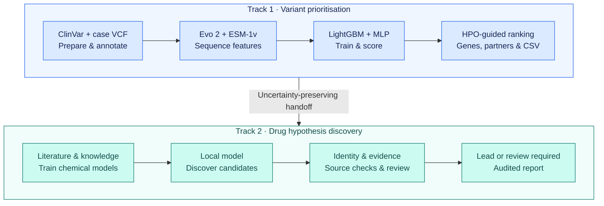

# Automatic variant prioritisation and drug hypothesis discovery for MVA

Working variant's submission to the **Rare Disease, Real Kid MVA Hackathon 2026** connects genomic foundation-model features, supervised variant classification, phenotype matching, automatic competition-CSV generation and local drug-hypothesis discovery with evidence auditing.

The final automatic analysis prioritised **BUB1B** and discovered **nicotinamide mononucleotide (NMN)** without a supplied compound list. It also identified unresolved genetic, functional and scientific-evidence questions and returned `review_required`. The team selects NMN as a **preclinical research hypothesis**, retaining those caveats. This is not a treatment recommendation or a demonstrated patient-cell rescue.

This repository contains the implementation and resource-building recipes for the final workflow, plus the [submission reports and recorded audit trail](submission/README.md). The submission folder includes case-derived predictions, clinical context and model transcripts. **No model checkpoints, embeddings, downloaded databases, raw patient inputs or API keys are included.** Foundation-model weights are downloaded separately; the variant ensemble and chemical target models are trained from public data. Superseded experimental drivers and the old manually curated submission generator have been removed from the working tree.

## Pipeline



### Track 1

1. Filter ClinVar pathogenic/likely pathogenic versus benign/likely benign labels. Merge overlapping gene groups and split approximately 80/10/10; hold BUB1B, CEP57 and TRIP13 groups out of training.
2. Build the consequence-stratified embedding subset and annotate with Ensembl VEP 115, using MANE-first transcript selection and `--distance 0`.
3. Generate Evo 2 7B likelihood changes and 16,384-dimensional embeddings using 4 kb windows, batch four and optional kernels disabled. Generate five-model ESM-1v missense scores and model-1 5,120-dimensional embeddings, using 1,022-residue windows where necessary.
4. Train LightGBM on scalars/PCA features and three-seed MLPs on full features. Average their probabilities. Population frequency and gene identity are excluded from learned features.
5. Normalise the case VCF, annotate and select candidates, generate features, and apply the trained ensemble. The historical preparation includes MVA-gene exceptions; it is not disease-neutral preparation.
6. Rank genes by `0.55 × highest eligible variant score + 0.45 × HPO similarity`. Order partner hypotheses while retaining original variant scores and uncertainty about phase/function. Automatically export up to ten hypotheses with uncalibrated EPCR priorities.

### Track 2

Local Muse-Glimmer-30B retrieves gene, disease and protein-regulation context, then proposes compounds without a seeded candidate list. Exact identity, supporting/opposing evidence, adult exposure and paediatric safety are examined through local tools. Discovery citations remain available during assessment. A separate context of the same model reviews structured evidence, with one bounded correction and fresh review. Deterministic checks retain source and compound-attribution failures.

The safety panel is rebuilt from ChEMBL 37 and ExCAPE-DB: unfolded ECFP4 fingerprints, scaffold splitting, Laplacian naive-Bayes models, and calibration. The historical serving panel had 913 core and 588 extended models. Predictions are screening outputs, not safety measurements. The final reasoning model uses its base weights; experimental LoRA training is not part of this workflow.

## Recorded results

| Measure | Historical result |
|---|---|
| ClinVar embedding subset | 271,170 variants across training, validation and test |
| Held-out ensemble AUROC | 0.9778 overall; 0.9694 missense |
| Case candidates scored | 40,629; repeat scoring matched stored scores exactly |
| Automatic Track 1 competition outcome | Team-reported 100/100 rank points and F-max 1.000 |
| Automatic Track 2 discovery | NMN and NPD11033 |
| Final scientific gate | `review_required`; no accepted research lead |
| Clinical suitability | `unestablished` |
| Recorded reasoning execution | 60 tool calls; 9 minutes 48 seconds Slurm wall time |

The team nominates the automatically generated NMN hypothesis for preclinical investigation. The genetic interpretation still requires phase and residual-function assessment. Protein abundance does not establish functional chromosome-segregation rescue, and adult exposure does not establish chronic paediatric safety. NMN's eligibility under the competition's market-approved-medication criterion was not established in this work.

These are recorded results, not an assertion that this portable packaging has repeated full training or GPU inference. The original complete scientific run used workflow 0.4.1; 0.5.0 added automatic CSV export with an identical ranking and equivalent handoff. This tree contains the final combined implementation, with portability and resource-validation changes. There is one maintained implementation, not multiple historical pipelines.

## Requirements

- Linux, Python and `uv` for environment setup.
- `bcftools`, `bgzip`, `tabix`, `samtools`, `wget`, `aria2c`, GNU core utilities and Apptainer for VCF/reference work and VEP.
- A CUDA toolkit compatible with the Evo 2 environment. Set `CUDA_HOME` for your machine if the build tools cannot locate it.
- Four suitable GPUs for the recorded tensor-parallel reasoning configuration. Feature generation and MLP training use one GPU at a time in the portable sequential runner. The original multi-GPU extraction timings therefore do not predict this runner's elapsed time.
- Substantial storage and memory: the ChEMBL database alone expands to roughly 29 GB, with additional reference caches, feature arrays and model weights. The recorded chemical-training and reasoning jobs requested up to 300 GB RAM. Plan capacity before starting.
- Network access for setup/resource acquisition and access approval for any gated inputs or model repositories. Case inference reads local resources.

The four Python environments are separate because Evo 2 and the reasoning runtime used different Torch/CUDA stacks. `envs/*.txt` pins direct dependencies and references recorded transitive constraints. These files document the observed environments; they are not a container image or a claim that every binary wheel is portable to every GPU/driver combination.

```bash
bash pipeline/setup_envs.sh
```

Tokens are supplied through `HF_TOKEN` or your existing Hugging Face credential store. Never put credentials into a tracked JSON, notebook or shell script. The installer records the resolved package set inside each ignored environment directory.

## Configure private inputs

Work from the repository root:

```bash
cp config/example.json config/local.json
mkdir -p inputs
```

Edit the ignored `config/local.json` to point to the authorised GRCh38 VCF and case JSON. Relative paths resolve from the checkout root; absolute paths supplied locally are supported. Set `cpus`, `tp`, `seed`, Python executable locations if needed, and a fresh `output` directory. No Slurm account or partition is embedded in the code.

The case JSON contains observed features, not an inferred causal gene, expected answer or candidate-drug list:

```json
{
  "case_id": "YOUR_CASE_ID",
  "data_class": "authorised_patient",
  "reuse_authorisation": "Provenance of your authorised access and use",
  "observed_hpo": ["HP:0004322"],
  "family_history_hpo": [],
  "phenotype": "Observed clinical features from the authorised source"
}
```

The example above is a schema illustration, not the hackathon case. Judges should use the supplied case's observed HPO terms and required submission identifier. Family-history features belong separately from proband phenotypes. The original observed HPO terms were manually transcribed; this interface does not claim automatic extraction of clinical observations from narrative text. For a public or synthetic case, choose the corresponding `data_class`.

Obtain the gated hackathon files through the organisers' authorised distribution. The optional downloader can retrieve them without embedding a token or case filename:

```bash
mva_llm/.venv-vllm/bin/python pipeline/download_case.py \
  --dataset SageBio/mva-hackathon-2026-data --revision DATASET_COMMIT \
  --out inputs/hackathon
```

Use an explicit dataset revision and set `patient_vcf` to the chosen file. The workflow starts from the provided VCF; FASTQ alignment and exploratory SV/MEI follow-up were not stages of the final automatic run and are not required for its reproduction. Raw reads, checkpoints, features and generated patient outputs stay ignored and remain subject to the dataset's access/retention conditions.

## Run from scratch

First inspect the complete plan; this needs only the standard Python library and does not download, train or submit anything:

```bash
python3 pipeline/run.py --config config/local.json --stage all --dry-run
```

Then execute inside an appropriately provisioned machine or allocation:

```bash
python3 pipeline/run.py --config config/local.json --stage all
```

For Slurm, submit from the checkout root and supply your own scheduler settings:

```bash
sbatch --account=YOUR_ACCOUNT --partition=YOUR_PARTITION \
  --gres=gpu:4 --cpus-per-task=32 --mem=300G --time=2-00:00:00 \
  pipeline/run.sbatch --config config/local.json --stage all
```

If compute nodes lack internet access, run acquisition stages on a suitable host first. Each stage can be run separately with the same runner:

| Stage | Work performed |
|---|---|
| `download` | Download Evo 2, five ESM-1v models and the local reasoning model at pinned repository revisions |
| `references` | Download GRCh38/ClinVar/peptides, index references, set up VEP and its cache |
| `training-data` | ClinVar filtering/splitting/subsampling and VEP annotation |
| `training-features` | ESM-1v and Evo 2 feature extraction |
| `train` | Assemble features, train LightGBM/MLP, build ensemble and evaluate held-out variants |
| `knowledge` | Build Open Targets/HPO/ClinVar tables, frozen-membership literature corpus, full text and chemical identities; acquire chemical-training resources |
| `chemical-models` | Train and calibrate chemical models; build essentiality, codependency, drug-safety and sibling-disease tables |
| `patient` | Normalise the authorised VCF, annotate with VEP and prepare candidates |
| `patient-features` | Generate case ESM-1v/Evo 2 features |
| `score` | Check the scoring path against saved validation predictions and score case candidates |
| `reason` | Check resources, rank genes/partners, export CSV, run local discovery/audit and write the report |

Stages execute sequentially and stop on a failing command. Stage dependencies must already exist when running an individual stage. Feature extraction retains its chunk-based resume behaviour. Other preparation/training stages may replace their generated artifacts; use a separate checkout/work area for a new experiment rather than mixing partially changed resources.

The runner logs commands and exit codes under the configured output directory. Reasoning requires a fresh analysis directory; completed checkpoints can be resumed directly:

```bash
mva_llm/.venv-vllm/bin/python mva_llm/unified/workflow.py \
  --config runs/case/workflow_config.json --out runs/case/analysis --resume
```

Resume validates input/code/runtime fingerprints and sealed checkpoints. Do not edit input or source files between execution and resume. To regenerate only ranking/export from prepared resources, use the same workflow command with `--track1-only` and a fresh output directory.

## Reproducing the evidence and results

`config/models.json` pins foundation-model revisions. `config/sources.json` records resource URLs and available historical checksums; `config/opentargets.json` selects the recorded release. `config/literature_ids.json` contains only the 26,256 public publication identifiers and query provenance in historical order, not article text or case data. The builder retrieves those records instead of issuing a new open-ended search.

`pipeline/check_resources.py` compares rebuilt resources with recorded semantic signatures, preserving table and corpus order. It also checks required model/table files before reasoning. Original file hashes are retained as additional provenance. Public services can update records, move an archive or block bulk access; an unavailable or changed resource is an explicit failure, not permission to silently use “latest.” An authorised copy of the exact resource can be placed at the configured destination and checked locally.

If you intentionally want a new analysis with changed reference content, set `"allow_reference_drift": true` in your private config after reviewing the differences. The differences are saved in `resource_check.json`. That run is **not** an exact historical-reference reproduction. Missing required resources always fail.

Identical inputs and a fixed seed improve reproducibility, but do not guarantee identical LLM text or scientific verdict across GPU hardware, kernels and runtime versions. The evidence audit may properly return review required. Reproduction must not hard-code NMN as a winner or bypass a failed gate. This package supports rebuilding and evaluating the workflow; it does not promise an identical therapeutic conclusion on changed evidence.

## Outputs

A [drug-recovery benchmark](docs/RECOVERY_BENCHMARK.md) now tests ranking across
six diseases and the full mapped FDA candidate pool with indication links hidden
from scoring. It reports retrieval failures and does not validate MVA efficacy.
The [uncapped-genetics and pathway comparison](docs/PATHWAY_BENCHMARK.md)
adds five frozen test families; neither extension passed its promotion rule.
The [BUBR1 rescue-evidence audit](docs/BUBR1_RESCUE_AUDIT.md) distinguishes
experimental rescue endpoints and checks selected approved-drug exposure links;
it supports mechanistic controls but establishes no approved rescue drug.
The [functional-characterization handoff](docs/FUNCTIONAL_CHARACTERIZATION.md)
defines the genetic-rescue pilot, measurements and advancement decisions, with
blank intake templates. Execution awaits a relevant cell model or functional data.
The [GSE22206 public-expression analysis](docs/GSE22206_ANALYSIS.md) provides
a downloaded single-case dataset, descriptive tissue-matched contrasts and a
74-gene measured-landmark query for a subsequent LINCS comparison.
The [completed LINCS comparison](docs/GSE22206_LINCS_REVERSAL.md) scores 544
eligible FDA ingredients, preserving condition-level evidence and separating
expression-reversal hypotheses from functional rescue claims.
The [fixed-candidate follow-up](docs/LINCS_FOLLOWUP.md) reviews the remaining
sixteen hits and tests cell-cycle exclusion, shRNA agreement and contextual
viability. It does not establish a replacement nomination.

A separate public-data [FDA-approved repurposing mode](docs/FDA_REPURPOSING.md)
builds an auditable ingredient catalogue and retrieves measured pharmacology
and related-disease hypotheses. It produces an unranked candidate pool without
changing the hackathon workflow or making therapeutic nominations.

The configured output contains command logs, resource checks and the generated workflow config. Its `analysis/` directory contains:

- Complete gene ranking and uncertainty-preserving handoff.
- `track1_submission.csv` and row-selection/EPCR audit.
- Discovery, initial and corrected candidate assessments, review and final gate.
- `report.md`, source ledger, complete tool/prompt/generation logs.
- Manifests, source snapshot and SHA-256 checkpoint sidecars.

The models trained locally remain under `track1/work/model/` and `gene_mol/models/`. Their existence on disk never makes them part of the Git submission. The pipeline does not upload competition submissions.

## Tests and repository checks

```bash
python3 -m unittest discover -s mva_llm/unified/tests -v
python3 -m unittest discover -s tests -v
python3 pipeline/check_repository.py
```

The original 28 workflow tests cover ranking, uncertainty, source/identity gates, correction semantics and CSV rendering. Portability tests cover stage ordering, generated configurations and response parsing. The repository check rejects machine-specific paths, likely credential values and forbidden data/checkpoint files. CPU tests do not replace a full GPU training/inference run.

See [the verification record](docs/VALIDATION.md) for completed replay checks and the remaining full-rebuild validation.

## Layout

| Directory | Purpose |
|---|---|
| `pipeline/` | Setup, download/build orchestration, resource verification and repository checks |
| `track1/scripts/` | ClinVar preparation, sequence features, supervised training and case scoring |
| `gene_mol/src/` | Chemical-model training/calibration and biological support tables |
| `mva_llm/src/` | Final-run local evidence tools and public knowledge builders |
| `mva_llm/unified/` | Automatic ranking, CSV export, discovery, review and reporting |
| `config/` | Public source/version metadata and example configuration |
| `envs/` | Recorded dependency pins and constraints |
| `examples/`, `tests/` | Artificial fixtures and tests; no patient inputs |
| `submission/` | Track 1 CSV/report, Track 2 report and recorded scientific audit trail |

Public resources and upstream models retain their own licences and access conditions. The team's report discloses API-based coding assistance; case reasoning in this workflow uses the local model and local evidence tools. No external inference API is required by the pipeline.

This work was made possible through the Hackathon, organized by Sage Bionetworks in partnership with the MVA Society, Hugging Face, and BEACON (The Benchmarking, Evaluation, and Assessment Consortium for Science), with prize sponsorship from AWS and Anthropic. We are deeply grateful to the child and their family who generously contributed their data and their story to advance research into this rare disease. We acknowledge their trust in making this Hackathon possible.
